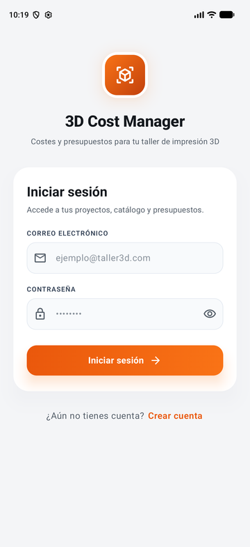
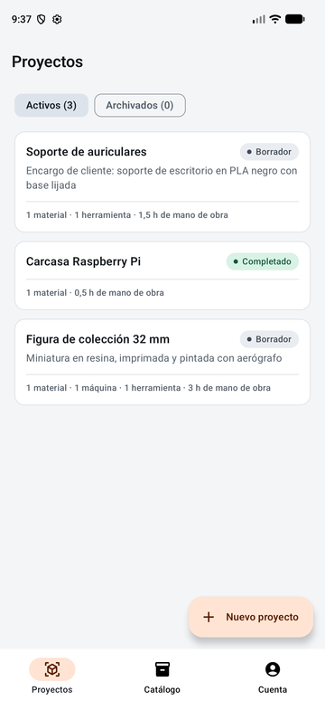
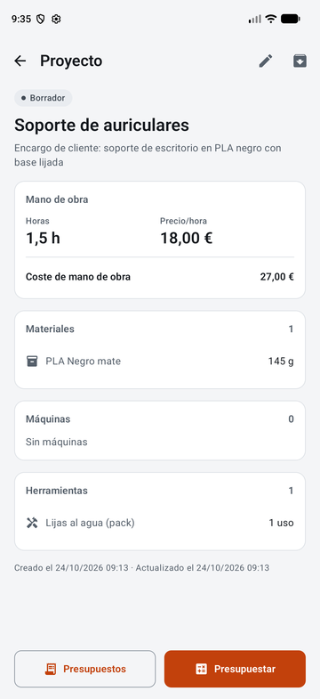
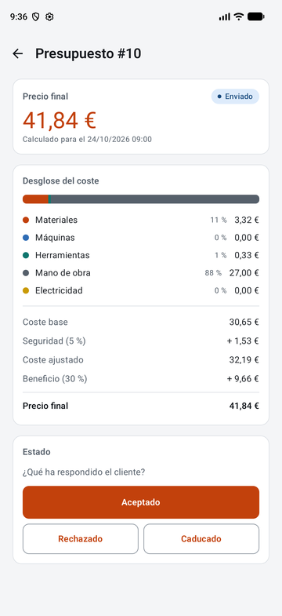
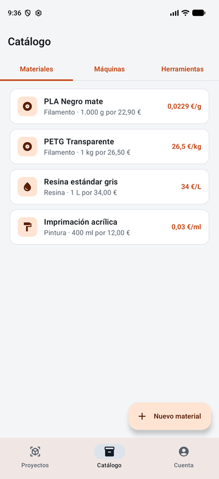
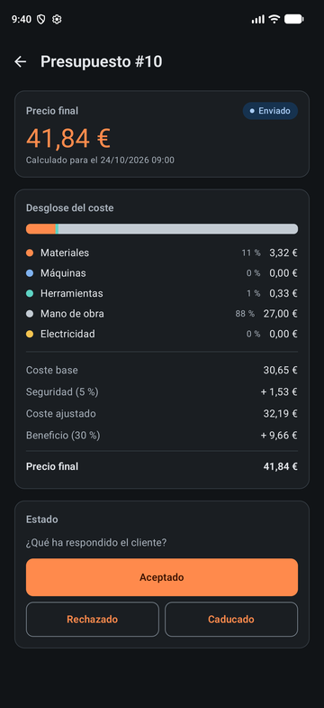

# 3D Cost Manager

Aplicación para calcular el coste de piezas impresas en 3D y generar presupuestos. Se compone de un backend REST en Java 21 / Spring Boot 3.2.5 y una app Android en Kotlin con Jetpack Compose.

A partir de un catálogo de recursos (materiales, máquinas y herramientas) y de la mano de obra de cada proyecto, el backend calcula el coste base, le aplica un margen de seguridad y un margen de beneficio, y guarda el resultado como presupuesto (*quote*). El consumo eléctrico de las máquinas se valora con el precio horario real de la API de ESIOS (Red Eléctrica).

<p align="center">
  
  
  
  
  
  
</p>

---

## Estructura del repositorio

| Carpeta | Contenido |
| :--- | :--- |
| [`backend/`](backend/) | API REST (Spring Boot, PostgreSQL, Flyway, JWT) |
| [`android/`](android/) | App Android (Jetpack Compose, MVVM, Retrofit) |
| [`infra/aws/`](infra/aws/) | Plantillas CloudFormation (VPC, RDS, EC2, Parameter Store) |
| [`docs/`](docs/) | Documentación técnica y [roadmap](docs/ROADMAP.md) |
| [`.github/workflows/`](.github/workflows/) | CI de backend y Android, despliegue a AWS |

---

## Backend

- **Dominio:** `Project` y `Quote` protegen sus reglas (un proyecto archivado no se puede modificar ni presupuestar).
- **Cálculo:** `CostCalculator` es lógica pura, sin dependencias de JPA. Usa `BigDecimal` con escala 8 en los cálculos intermedios y escala 4 en el resultado (`HALF_UP`).
- **Persistencia:** PostgreSQL 16, migraciones con Flyway y Hibernate en modo `ddl-auto=validate`.
- **Seguridad:** JWT sin estado y contraseñas con BCrypt. `JWT_SECRET` es obligatorio: si falta o no es una clave Base64 de al menos 256 bits, la aplicación no arranca.
- **Datos por usuario:** cada usuario solo ve y modifica sus propios catálogos, proyectos y presupuestos. Un recurso de otro usuario responde 404.
- **Errores:** todas las respuestas de error siguen el formato `ApiError` descrito en [`docs/API_ERROR_CONTRACT.md`](docs/API_ERROR_CONTRACT.md).

### Ejecutar en local

Requisitos: JDK 21 y Docker.

```bash
cp .env.example .env          # revisa los valores; genera tu JWT_SECRET con: openssl rand -base64 32
docker compose up --build -d
curl http://localhost:8080/api/v1/health
```

Sin un `ESIOS_API_TOKEN` válido el backend arranca, pero no puede generar presupuestos porque no obtiene el precio de la electricidad.

### Tests

```bash
cd backend
./mvnw clean verify           # en Windows: mvnw.cmd clean verify
```

Los tests de integración usan Testcontainers, así que necesitan Docker en marcha. El test contra la API real de ESIOS está deshabilitado por defecto porque requiere un token personal.

---

## App Android

- **Proyectos:** cada encargo con su mano de obra, materiales, máquinas y herramientas. Por ahora las líneas de materiales, máquinas y herramientas solo se pueden añadir a través de la API; añadirlas desde la app es la Fase 5 del roadmap.
- **Catálogo:** materiales, máquinas y herramientas con el coste unitario que usa el cálculo (€/g, €/h, €/uso).
- **Presupuestos:** precio final con el desglose por partida y su ciclo de vida (borrador, enviado, aceptado…).
- Tema propio en modo claro y oscuro, y formato español en importes, cantidades y fechas.

Requisitos: Android Studio con el SDK 34 y JDK 21 (el JDK que trae Android Studio sirve).

```bash
cd android
./gradlew test assembleDebug
adb install app/build/outputs/apk/debug/app-debug.apk
```

La app se conecta a `BuildConfig.BASE_URL`, que por defecto es `http://10.0.2.2:8080/`: la dirección del equipo anfitrión vista desde el emulador. Para un teléfono físico o para producción, consulta [`docs/ANDROID_BUILD_GUIDE.md`](docs/ANDROID_BUILD_GUIDE.md).

La configuración `release` todavía apunta a esa misma URL de desarrollo y no está firmada, así que la APK release no está lista para distribuirse (Fase 6 del roadmap).

---

## CI/CD y AWS

- **Backend:** cada PR contra `develop` o `main` ejecuta `./mvnw clean verify`. Un push a `main` construye la imagen Docker ARM64, la publica en Amazon ECR y la despliega en EC2 mediante SSM.
- **Android:** cada PR contra `develop` o `main` que toque `android/` ejecuta los tests y compila la APK debug.
- **Infraestructura:** las plantillas de `infra/aws/` y la guía de [`docs/aws/`](docs/aws/) describen el entorno previsto. **No se ha verificado un despliegue real** en una cuenta AWS.

---

## Estado y próximos pasos

Las fases hechas y pendientes, con su Issue, están en [`docs/ROADMAP.md`](docs/ROADMAP.md).
