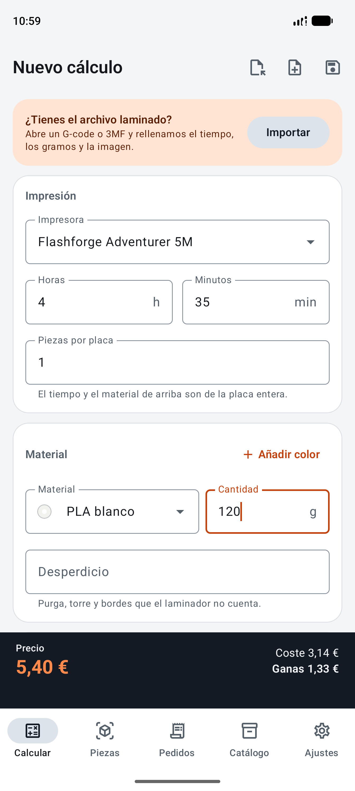
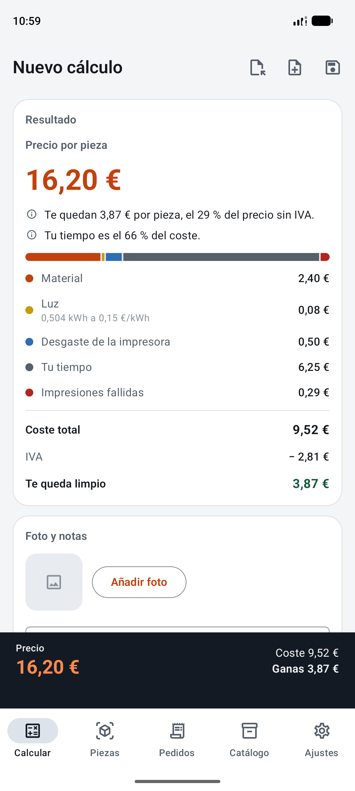
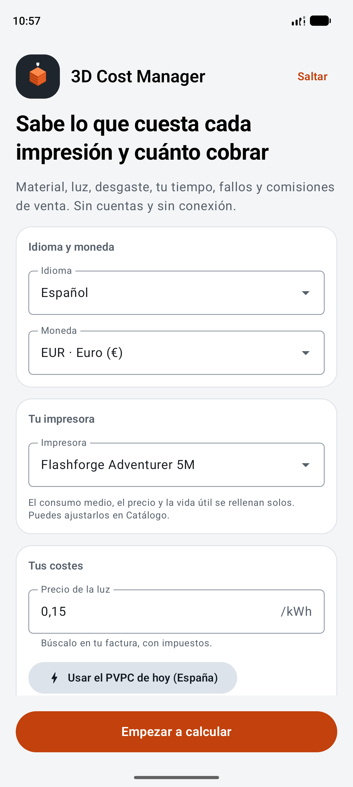
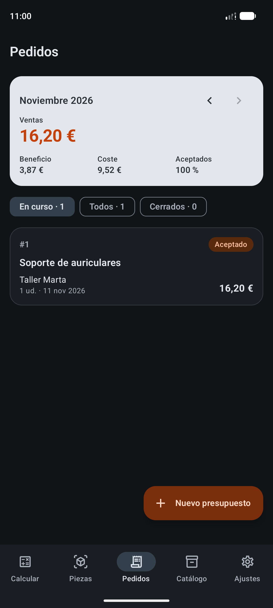

# 3D Cost Manager

App Android para saber lo que cuesta cada pieza impresa en 3D y a cuánto venderla, y para gestionar presupuestos y pedidos. Funciona entera en el móvil: sin cuenta, sin servidor y sin conexión, en español e inglés.

Para particulares que quieren saber cuánto les cuesta una impresión y para negocios que presupuestan y venden en Etsy, Wallapop, Amazon o en su tienda.

---

## Qué hace

| Área | Funciones |
| :--- | :--- |
| **Calculadora** | Material (varios colores por pieza y desperdicio), luz, desgaste de la impresora, tu tiempo (preparación por placa y acabado por pieza), extras, impresiones fallidas y piezas por placa. Resultado en vivo con desglose y frases que lo explican. |
| **Precio de venta** | Margen sobre el coste, beneficio fijo por pieza o precio fijo. Comisiones del canal de venta e IVA incluidos, con redondeo hacia arriba opcional. |
| **Importar del laminador** | Abre o comparte un G-code o 3MF laminado (Flash Studio, OrcaSlicer, Bambu Studio, PrusaSlicer, Cura) y se rellenan el tiempo, los gramos de cada filamento y la imagen de la pieza. |
| **Piezas** | Cálculos guardados con foto, para reutilizarlos y añadirlos a presupuestos. |
| **Pedidos** | Presupuestos con cliente, piezas, cantidades, descuento, envío y estado (borrador → enviado → aceptado → impreso → entregado). PDF con el logo y los datos del negocio para enviarlo por WhatsApp o correo. Resumen del mes: ventas, coste, beneficio y tasa de aceptación. |
| **Catálogo** | Impresoras con plantillas (Flashforge, Bambu Lab, Prusa, Creality, Elegoo, Anycubic), materiales con stock de bobinas y aviso de bobina baja, extras y canales de venta con sus comisiones. Al marcar un pedido como impreso se descuenta el filamento. |
| **Ajustes** | Idioma, moneda, tema, valores por defecto, precio de la luz (en España, el PVPC del día con un botón), datos del negocio, guardar imágenes para uso sin conexión, borrar caché, copia de seguridad y restauración, borrar todos los datos, enviar comentarios, valorar, compartir y privacidad. |
| **Publicidad** | Una barra arriba que solo ocupa espacio cuando hay un anuncio cargado. Consentimiento UMP para la UE. |

<p align="center">
  
  
  
  
</p>

---

## Estructura del repositorio

| Carpeta | Contenido |
| :--- | :--- |
| [`android/`](android/) | La app (Kotlin, Jetpack Compose, Room, DataStore) |
| [`backend/`](backend/) | API REST de la versión anterior (Spring Boot). **Archivada**: la app ya no la necesita; se conserva por si se añade sincronización en la nube. |
| [`infra/aws/`](infra/aws/) | Plantillas CloudFormation del backend archivado |
| [`docs/`](docs/) | Documentación y [roadmap](docs/ROADMAP.md) |

---

## App Android

### Arquitectura

```
android/app/src/main/java/com/tdcostmanager/app/
├── core/calc/        Motor de cálculo puro (BigDecimal) y cuentas de pedidos
├── core/importer/    Lectura de G-code y 3MF
├── core/             PDF, copia de seguridad, imágenes, PVPC, formato, anuncios
├── data/db/          Room: entidades y DAO
├── data/settings/    Ajustes en DataStore
├── data/             Repositorio y catálogo inicial (plantillas)
└── ui/               Pantallas Compose por sección
```

- **Cálculo:** `CostEngine` es Kotlin puro, sin Android. Escala 8 en los pasos intermedios y 4 en el resultado (`HALF_UP`). Una placa fallida repite material, luz, desgaste y preparación; el acabado y los extras no.
- **Precio:** el precio con IVA se despeja para que, tras el IVA y la comisión del canal (que se cobra sobre el total), quede el beneficio buscado.
- **Datos:** todo en el dispositivo. La copia automática de Android incluye la base de datos, los ajustes y las imágenes; la copia manual es un `.zip` con `backup.json` y las imágenes.
- **Presupuestos auditables:** cada línea congela su precio y su coste al añadirla. «Actualizar precios» los recalcula con el catálogo actual.
- **Idiomas:** inglés por defecto y español. Los textos se editan en [`android/scripts/strings.py`](android/scripts/strings.py), que genera los dos `strings.xml` con las mismas claves.

### Compilar y probar

Requisitos: Android Studio con el SDK 35 y JDK 17 o superior.

```bash
cd android
./gradlew test assembleDebug
adb install app/build/outputs/apk/debug/app-debug.apk
```

La versión de depuración se instala como `com.tdcostmanager.app.debug`, junto a la de producción, y siempre usa anuncios de prueba.

### Publicar

1. **Firma:** crea `android/keystore.properties` (no se versiona) con `storeFile`, `storePassword`, `keyAlias` y `keyPassword`. Sin él, `assembleRelease` genera una APK sin firmar.
2. **AdMob:** pon tus identificadores en `~/.gradle/gradle.properties`:
   ```properties
   ADMOB_APP_ID=ca-app-pub-XXXXXXXXXXXXXXXX~YYYYYYYYYY
   ADMOB_BANNER_ID=ca-app-pub-XXXXXXXXXXXXXXXX/ZZZZZZZZZZ
   ```
   Sin ellos, la release usa los identificadores de prueba de Google (no generan ingresos).
3. `./gradlew bundleRelease` y sube el `.aab` a Google Play.
4. Google Play pide una URL pública con la política de privacidad: el texto de la pantalla «Privacidad» de la app sirve de base.

El correo que recibe los comentarios de los usuarios está en `FEEDBACK_EMAIL`, en [`android/app/build.gradle.kts`](android/app/build.gradle.kts).

---

## CI

- **Android:** cada PR contra `develop` o `main` que toque `android/` ejecuta los tests y compila la APK debug.
- **Backend:** sigue con su CI propio mientras esté en el repositorio.

## Estado y próximos pasos

Las fases hechas y pendientes, con su Issue, están en [`docs/ROADMAP.md`](docs/ROADMAP.md).
